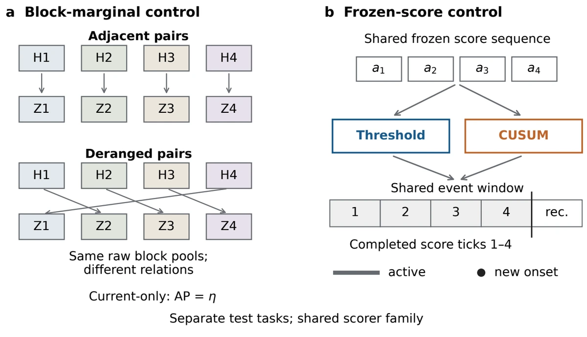

An anomaly detector produces a score. Someone monitoring a system needs a warning while there is still time to respond. Between those two outputs sit several choices: when a score becomes available, whether to act on it immediately, whether to accumulate evidence, and when an existing alarm should count as a new warning. My Signature Work studies this gap by separating the information a detector uses from the decisions made with its scores.

## The same ranking can yield different warnings

Consider three events, each lasting four observation blocks. Place one high score at the beginning of each event. A threshold rule can warn during all three. Now move those same three high scores into consecutive blocks of a single event. The positive examples retain exactly the same score distribution, and the negative examples are unchanged. Average precision and AUROC therefore stay fixed, even though the warnings cover fewer events.

In the analytic construction in my thesis, both arrangements have AP **0.750** and AUROC **0.625**. The spread arrangement detects three of three events, each after 64 samples. The concentrated arrangement detects one of three, after 128 samples. Consecutive active ticks count as one alarm interval. These are constructed sequences showing what ranking metrics leave unspecified: they retain score–label relationships while discarding the order that determines event coverage and delay.

## Hold the scores fixed

This observation also helps distinguish two uses of history. A model can use earlier observations to judge whether the current observation is unusual. An alarm rule can accumulate earlier scores before deciding to warn. To investigate the first, I paired the same raw history and current blocks in different ways. A fixed detector reading only the current block then has identical score distributions in the two classes; any useful distinction must come from their relationship. To investigate the second, I kept the fitted score at every time step fixed and changed the alarm rule.

{fig-alt="A schematic of matched history–current block pairs and threshold versus CUSUM alarm rules applied to the same scores." width=640}

For the alarm comparison, a threshold responds to an individual score, while CUSUM accumulates transformed score evidence over time. Both receive scores from the same contextual model trained on normal data. In the primary simulated experiment, each rule uses 50,000 normal calibration ticks, a nominal budget of 100 new alarm onsets per 10,000 ticks, and a 5% alarm-occupancy cap. Each score arrives only after its 64-sample block is complete. A hit requires a new alarm onset during the event; an alarm already active when the event starts receives no credit.

## Read recall alongside warning burden

The two simulated transition patterns give the following results with fixed fitted detectors:

| Setting | Threshold event recall | CUSUM event recall | Threshold / CUSUM normal onsets |
|:--|--:|--:|--:|
| Ring | 19.2% | 28.8% | 98.15 / 94.65 |
| Cluster | 7.8% | 10.7% | 102.85 / 93.45 |

Recall counts detections within four completed blocks and keeps every event in the denominator. Normal onsets are measured per 10,000 score ticks on independent normal streams. The common calibration target does not make the observed warning costs identical. Reporting those costs beside recall is necessary to understand what each operating point provides.

The recall gains also need a timing explanation. In the ring setting, CUSUM detects 128 events that thresholding misses, while thresholding detects 32 that CUSUM misses, among 1,000 scheduled events. That difference accounts for the 9.6-percentage-point recall gain. On events both rules detect, CUSUM is usually equally fast or slower. Its advantage comes from covering additional events. A utility measure that includes misses and rewards earlier warnings improves clearly for ring; the corresponding cluster interval includes zero.

## What changes in real series

Evaluation on 119 real series from five sources makes the operating-point issue more visible. Accumulation provides no consistent detection gain. In the eight-sample-block comparison, CUSUM reduces both mean event recall and warnings during normal-labeled periods on four sources. Those warning counts describe the normal-labeled portions of mixed streams, where alarm state can carry over from an event. They answer a different question from the independent normal-stream rates in the simulation.

For me, a convincing claim about better alarms needs a paired explanation: which events were gained or lost, when the shared detections occurred, and what warning burden accompanied the change. A useful next comparison would examine event coverage and timing across overlapping ranges of *measured* warning burden. That would help distinguish benefits from accumulated evidence from changes caused by operating at a different alarm cost. A better score creates an opportunity; the deadline and decision rule determine how much of that opportunity reaches the person monitoring the system.

[Research project](../projects.qmd#contextual-anomaly-detection) · [All research notes](index.qmd)
