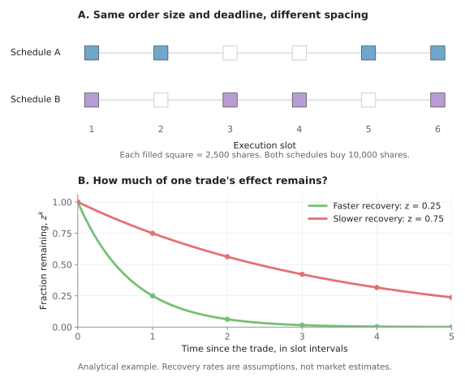
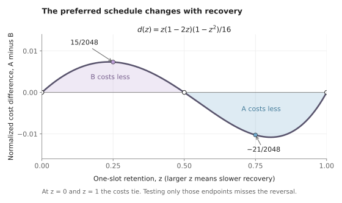
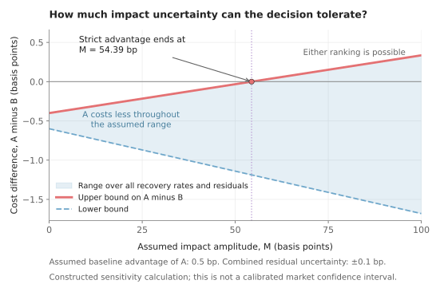

Suppose I need to buy 10,000 shares before a deadline. I split the purchase into four orders of 2,500 shares. I can send two orders early and two late, or spread the middle two across the session. Which arrangement costs less?

A historical order book gives me a useful starting point. It records prices and quantities offered by other traders. I can calculate what my orders would pay against those recorded offers. But after my first purchase, other traders might replenish the offers, withdraw them, or change their prices. The historical record contains the market without these particular orders. It does not contain the market's response to them.

This gap matters when a backtest becomes a decision. A strategy can look affordable at small size and become expensive as its own trading changes the opportunities it relies on. I encountered the issue while building an [L2-based factor-capacity tool](../tools.qmd#l2-factor-capacity). Level-2 data records quoted prices and quantities at several levels of the order book. Following cash, holdings, and incomplete orders made me ask a further question: what can I conclude when the response to my own trading remains unknown?

There is a useful answer for a restricted comparison. Two execution schedules can share a large unknown cost. Comparing them under the **same market response** can remove that shared uncertainty. To see both the opportunity and its limits, start with four orders and six time slots.

## Four orders, two ways to wait

Call the schedules A and B. Divide the execution window into six equally spaced slots. Each schedule buys one quarter of the total quantity in every occupied slot:

$$
w_A=\tfrac14(1,1,0,0,1,1),\qquad
w_B=\tfrac14(1,0,1,1,0,1).
$$

The entries are fractions of the 10,000 shares. Both schedules start in slot 1 and finish in slot 6. They differ only in the timing of their middle orders. For this example, assume every order completes and both schedules have the same cost against the recorded books. These are constructed conditions, not measured market results.

Now suppose an order temporarily raises the prices paid by later orders. Let $z$ be the fraction of that effect remaining one slot later. After $k$ slots, the fraction remaining is $z^k$. A small $z$ means fast recovery; a value near one means the effect persists.

{fig-alt="Schedule A buys in slots 1, 2, 5, and 6. Schedule B buys in slots 1, 3, 4, and 6. Each order contains 2,500 shares. Below, powers of 0.25 decay faster than powers of 0.75." width=800}

With fast recovery, A pays for having two pairs of adjacent orders. B has only one adjacent pair. With slower recovery, more distant pairs also matter, and that simple count no longer tells us which arrangement is cheaper.

## Count what each earlier order leaves behind

We can calculate the difference by considering pairs of orders. If a fraction $w_t$ trades now and $w_{t+k}$ trades $k$ slots later, their contribution is proportional to

$$
w_t w_{t+k}z^k.
$$

The first factor determines how much pressure the earlier order creates. The second determines how much of the later order pays for it. The last determines how much pressure remains. Summing over pairs gives a dimensionless schedule function,

$$
p_w(z)=\sum_{k=1}^{5}a_k(w)z^k,
\qquad
a_k(w)=\sum_{t=1}^{6-k}w_tw_{t+k}.
$$

Here $a_k$ counts pairs separated by $k$ slots, weighted by their sizes. It is the schedule's autocorrelation at that lag. Every nonzero pair in our example contributes $1/16$ before the recovery factor. Counting the pairs gives

$$
p_A(z)=\frac{2z+z^3+2z^4+z^5}{16},\qquad
p_B(z)=\frac{z+2z^2+2z^3+z^5}{16}.
$$

Subtracting gives

$$
d_{AB}(z)=p_A(z)-p_B(z)
=\frac{z(1-2z)(1-z^2)}{16}.
$$

If a positive coefficient $\lambda$ sets the strength of this response, the extra cost difference is $\lambda d_{AB}(z)$. Measure $\lambda$ in basis points of the common initial order value, so the difference is also in basis points. One basis point is $0.01\%$ of that value.

At $z=1/4$, the difference is $15\lambda/2048>0$: A costs more. At $z=3/4$, it is $-21\lambda/2048<0$: A costs less. For an illustrative $\lambda=100$ basis points, these differences are about $+0.73$ and $-1.03$ basis points. The coefficient is a hypothetical scale, not a calibration.

{fig-alt="The polynomial dAB is positive between zero and one half and negative between one half and one. At z=0.25 it equals 15/2048; at z=0.75 it equals minus 21/2048. It vanishes at both endpoints." width=800}

Both response mechanisms can be paired with exactly the same historical market when our orders are absent. A history-only procedure then receives the same input in the two worlds, although the better schedule differs. Running the replay more times cannot tell those worlds apart.

In causal-inference language, the missing quantity is an intervention response. In reinforcement-learning language, the action changes the next state, but a fixed historical tape keeps supplying the old next state. Public order flow may help under assumptions that connect its response to ours. The recorded tape alone does not establish that connection.

## An unknown cost can cancel

There is no universally preferred schedule when both recovery speeds remain possible. But some unknown effects matter much less for a comparison than for either cost separately.

Consider an additional permanent response. Let $\gamma\ge0$ set its strength, also measured in basis points, with no known upper bound. Every earlier order affects every later order without decaying. Its contribution is

$$
\gamma\sum_{s<t}w_sw_t
=\frac{\gamma}{2}\left(1-\sum_t w_t^2\right).
$$

The identity follows by expanding $(\sum_t w_t)^2=1$. Because A and B contain the same four quarter-size orders, $\sum_t w_t^2=1/4$. Each pays the same permanent term, $3\gamma/8$, whatever the timing.

We may have no finite upper bound on either schedule's absolute cost. Their difference still loses this permanent term exactly. We subtract two finite costs within each possible market, then consider all the markets; we never subtract infinity from infinity.

This is why I compare both schedules under one shared mechanism. Giving A the most expensive possible market and B a different, cheap market throws away the cancellation. Such separate bounds can be valid and still tell us very little about choosing between A and B in the same market.

The matching condition matters. The four individual orders are often called child orders of the original purchase. Changing their sizes can change $\sum_t w_t^2$, so this particular cancellation need not survive. This comparison concerns when to send the same orders.

## Ask how much uncertainty the decision can tolerate

A market need not recover at a single speed. A standard transient-impact model allows a positive mixture of fast and slow exponential responses. This family appears in the work of [Gatheral, Schied, and Slynko](https://onlinelibrary.wiley.com/doi/10.1111/j.1467-9965.2011.00478.x) and [Alfonsi and Schied](https://arxiv.org/abs/1201.2756). Here I use it as a declared sensitivity model for the additional effect between orders.

A mixture might combine a fast response at $z=1/4$ with a slower one at $z=3/4$. Its contribution would be $\lambda_1d_{AB}(1/4)+\lambda_2d_{AB}(3/4)$, with nonnegative strengths $\lambda_1$ and $\lambda_2$. An integral allows a whole range of speeds. Write the comparison as

$$
\Delta C_{AB}
=\Delta b_{AB}
+\int_0^1 d_{AB}(z)\,\mu(dz)
+e_A-e_B.
$$

$\Delta C_{AB}$ is A's expected cost minus B's. $\Delta b_{AB}$ is their expected reference-cost difference against recorded books. The nonnegative measure $\mu$ assigns response strength to different recovery speeds. For example, a single speed with strength $\lambda$ puts all its mass at that speed. Finally, $e_A$ and $e_B$ allow discrepancies between the assumed response model and the costs being compared. All three terms have units of basis points.

Suppose we allow total response strength at most $M$, so $\mu([0,1])\le M$, and discrepancies $|e_A|\le\varepsilon_A$, $|e_B|\le\varepsilon_B$. Define $E=\varepsilon_A+\varepsilon_B$. The largest possible cost difference is

$$
U_{AB}(M)=\Delta b_{AB}
+M\max\!\left\{0,\max_{0\le z\le1}d_{AB}(z)\right\}
+E.
$$

The reason is short. A nonnegative mixture cannot exceed its total mass times the largest value of $d_{AB}$. If that maximum is positive, putting all allowed mass at a maximizing recovery speed attains the bound. If every value is nonpositive, the zero-response mixture gives the largest value. Allowing each discrepancy to vary freely within its interval contributes the most adverse difference, $E$.

Thus $U_{AB}(M)\le0$ means A costs no more than B throughout this specified class. If the bound is positive, it does not automatically make B better. It means this test has not established that A is better. Additional restrictions linking the discrepancies could tighten the bound.

For a numerical example, now give A a reference-cost advantage of $0.5$ basis points and allow a combined discrepancy of $0.1$ basis points. These are new hypothetical inputs. The upper bound starts at $-0.4$ basis points and increases with $M$. Its zero crossing tells us how much assumed feedback the comparison can tolerate.

{fig-alt="The worst allowed cost difference rises from minus 0.4 basis points as the assumed response-strength budget grows. Below its zero crossing, A is no more costly than B for every response in the specified class. Above it, that ordering is unresolved." width=800}

The threshold in this construction is approximately $54.39$ basis points. Below it, the assumed reference advantage survives every allowed response and discrepancy. Above it, the stated assumptions permit a reversed ranking. I find this threshold more informative than choosing one unexplained impact coefficient. Historical replay does not tell us the real market's location on the horizontal axis.

::: {.callout-note collapse="true" title="The comparison in its more general form"}

For two distinct complete schedules $w$ and $v$ with the same multiset of child-order sizes, the permanent term cancels. Let $d=p_w-p_v$, $\Delta b=b(w)-b(v)$, and $E=\varepsilon_w+\varepsilon_v$. Over every nonnegative response mixture of mass at most $M$ and freely varying residuals in their stated intervals, the exact range of cost differences is

$$
\left[
\Delta b+M\min\{0,\min_z d(z)\}-E,
\quad
\Delta b+M\max\{0,\max_z d(z)\}+E
\right].
$$

"Exact" refers to this allowed class: the endpoints are attained by a zero mixture or a mixture concentrated at one recovery speed, together with endpoint discrepancies. It does not establish that the class contains the real market. A schedule compared with itself has exactly zero difference, including its shared discrepancy.

If no finite amplitude bound is available, $w$ is no more costly for every finite positive mixture precisely when

$$
\Delta b+E\le0
\quad\text{and}\quad
d(z)\le0\ \text{for every }z\in[0,1].
$$

A positive value of $d$ lets an arbitrarily large response concentrated there reverse the ordering. If $d$ is never positive, every allowed mixture preserves it. This gives a useful decision even without knowing the amplitude, when the schedule geometry satisfies the condition.

The comparison assumes marketable orders, meaning orders intended to execute immediately against available opposite quotes. It also assumes completion of the stated quantities, schedules fixed using information available before execution, and one common response mechanism. Adaptive policies, passive queue positions, changing order sizes, and cross-asset feedback require further analysis. The immediate visible-book cost is already in $b$; the extra term models effects of earlier orders on later ones and does not charge that visible depth again.

:::

## What I would test before trusting the comparison

There are two different reasons a reported bound can be wrong. The calculation may miss a recovery speed where the cost difference is larger. Or the calculation may be correct for a response class that does not describe the market.

The first problem is computational. Since $d$ is a polynomial, its extrema occur at endpoints or stationary points. A coarse grid can miss the worst case. For these figures, I checked the six-slot algebra exactly and bounded the extrema with rational polynomial subdivision. In the working method, a conservative numerical upper bound is what should enter a decision.

The second problem needs evidence about responses. An interactive simulator can generate paired worlds with and without our orders, using the same background randomness. That tests the comparison inside its mechanism. A simulator with different replenishment or nonlinear feedback can then test what happens outside the assumed class. Passing either test would still need a justified connection to the real market.

Even the reference-cost difference may need estimation across trading episodes. Its sampling uncertainty must be included, especially if many schedules are compared and the best-looking one is selected afterward. More independent episodes can reduce that statistical error. They do not automatically reduce the response budget $M$ or the discrepancy allowances. The manuscript's market-data study and interactive-simulator experiments remain planned work; the examples here are analytic constructions.

## Where this leaves the capacity tool

The current tool follows a different, already implemented part of the problem. It replays orders against historical L2 data, tracks cash and holdings, and tests whether every original legal order completes on its planned day. Buying 9,900 of 10,000 planned shares remains incomplete. Approved exceptional extensions are recorded separately; they do not change the original day's result.

The tool also has an explicit, uncalibrated scenario for additional impact costs. Those costs enter the cash calculation before fills, so they can change affordable quantities and later holdings. The historical quotes themselves do not react to the account. This is a useful cost-sensitivity experiment, while the shared-response comparison above is a separate research method. Its theorem does not establish the capacity of a whole trading strategy.

The distinction changes what I want from an execution report. Alongside the cost under a chosen scenario, I want to know which comparisons survive a range of responses, what would reverse them, and where the available information leaves the choice unresolved. For the two schedules here, a single recovery parameter already explains why identical history can leave opposite decisions open.

::: {.source-credit}
Further reading

- Jim Gatheral, Alexander Schied, and Alla Slynko. [*Transient linear price impact and Fredholm integral equations*](https://onlinelibrary.wiley.com/doi/10.1111/j.1467-9965.2011.00478.x). 2012.
- Aurélien Alfonsi and Alexander Schied. [*Capacitary measures for completely monotone kernels via singular control*](https://arxiv.org/abs/1201.2756). 2013.

The six-slot construction and comparison bounds are developed in my working manuscript, *Execution Decisions under Unidentified Market Impact*. Figures show exact or numerically bounded model calculations, not estimates from real trades.
:::

[L2 factor-capacity tool](../tools.qmd#l2-factor-capacity) · [Research notes](index.qmd)
