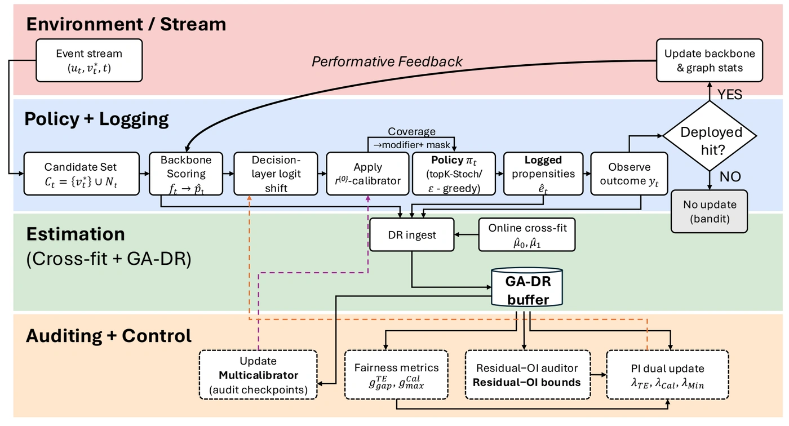
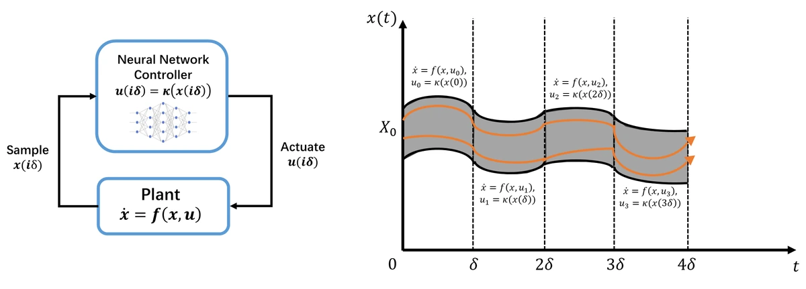

:::: {.profile}
::: {.profile-photo-wrap}

::: {.profile-links}
[CV](assets/Shengen_Li_CV.pdf) / [GitHub](https://github.com/lsnnnnnnnn) / [Email](mailto:sl879@duke.edu)
:::
:::
::: {.profile-heading}
<h1>Sheng’en Li</h1>
:::

::: {.profile-bio}
I study Applied Mathematics and Computer Science as an undergraduate in the dual-degree program at [Duke Kunshan University](https://www.dukekunshan.edu.cn/) and [Duke University](https://duke.edu/).

My research asks how to evaluate and improve learning and decision systems when decisions shape future data, observations depend on past ones, or we are uncertain about the model. My work spans counterfactual evaluation, sequential detection, and numerical verification.

Oh, and these are my [notes](blog/index.qmd){.intro-link .intro-notes} and [tools](tools.qmd){.intro-link .intro-tools}. You might want to have a look.
:::
::::

---

## News

- **[Nov. 2026]** I presented my [Signature Work](projects.qmd#contextual-anomaly-detection) at the showcase.
- **[Apr. 2026]** [COPF](https://arxiv.org/abs/2606.00700) was accepted to **ICML 2026**.
- **[Jul. 2025]** [DECAF-GAD](https://arxiv.org/abs/2508.10785) was accepted to **ECAI 2025**.

---

## Selected Publications

::: {.publication}
### [COPF: An Online Framework for Deployment-Stable Counterfactual Fairness in Evolving Graphs](https://arxiv.org/abs/2606.00700)

**Sheng’en Li**, Dongmian Zou  
ICML 2026 · First author  
[paper](https://arxiv.org/abs/2606.00700)
:::

::: {.publication}
### [DECAF-GAD: Enhancing Fairness in Autoencoders for Node-Level Graph Anomaly Detection](https://arxiv.org/abs/2508.10785)

Shouju Wang\*, Yuchen Song\*, **Sheng’en Li\***, Dongmian Zou  
ECAI 2025 · Co-first author  
[paper](https://arxiv.org/abs/2508.10785)
:::

::: {.publication-note}
\* Equal contribution.
:::

::: {.publication-index}
[Full publication list →](publications.qmd)
:::

---

## Selected Research Projects {#research-projects}

:::: {.research-row}

::: {}
### [Counterfactual Learning for Adaptive Decision Systems](projects.qmd#counterfactual-learning)

::: {.entry-meta}
Duke Kunshan University / Duke University · Jan. 2025 – Present
:::
::: {.research-summary}
I developed COPF to track and adjust disparities in who receives recommendations as the network evolves.
:::
:::
::::

:::: {.research-row}

::: {}
### [Contextual Information and Alarm Utility in Time-Series Anomaly Detection](projects.qmd#contextual-anomaly-detection)

::: {.entry-meta}
Duke Kunshan University · Signature Work · 2025 – 2026
:::
::: {.research-summary}
I study when past observations help detect an anomaly and whether an alarm arrives before the event ends.
:::
:::
::::

:::: {.research-row}

::: {}
### [Taylor-Model Reachability for Neural-Network-Controlled Systems](projects.qmd#verified-reachability)

::: {.entry-meta}
UIUC · Prof. Huan Zhang’s group · May 2026 – Present
:::
::: {.research-summary}
I’m building a PyTorch engine that bounds the paths a system can take under a neural network controller.
:::
:::
::::

::: {.publication-index}
[All research projects →](projects.qmd)
:::

---

## Work Experience

::: {.simple-row}
::: {}
**Shangchen Private Fund** · Shanghai, China  
Quantitative Research Intern (Sep. 2026 – Present)  
Previously Quantitative Developer Intern (Jul. – Sep. 2026)
:::
::: {.row-date}
Jul. 2026 – Present
:::
:::

I backtest factor strategies under liquidity constraints and study macroeconomic consensus. In my earlier developer role, I worked on financial document retrieval and on data pipelines in Python and SQL.

