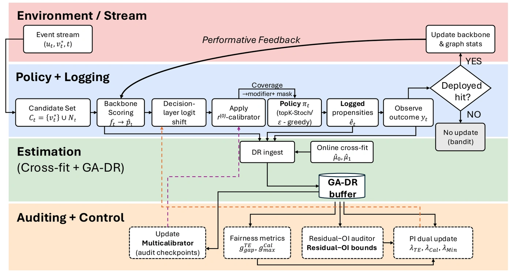
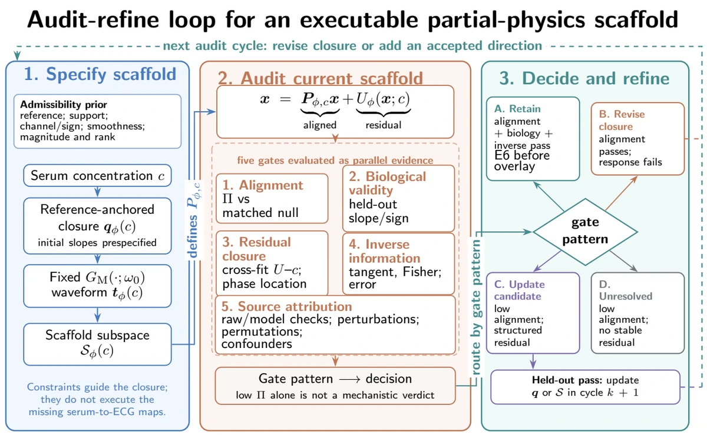
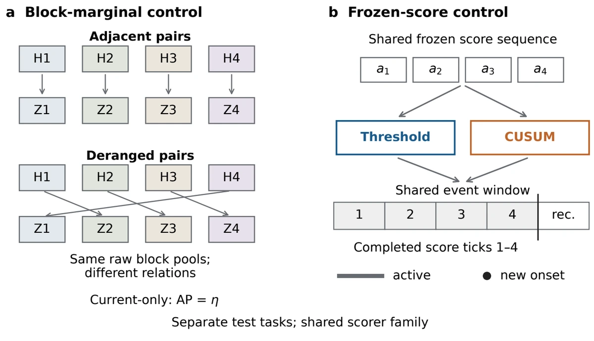
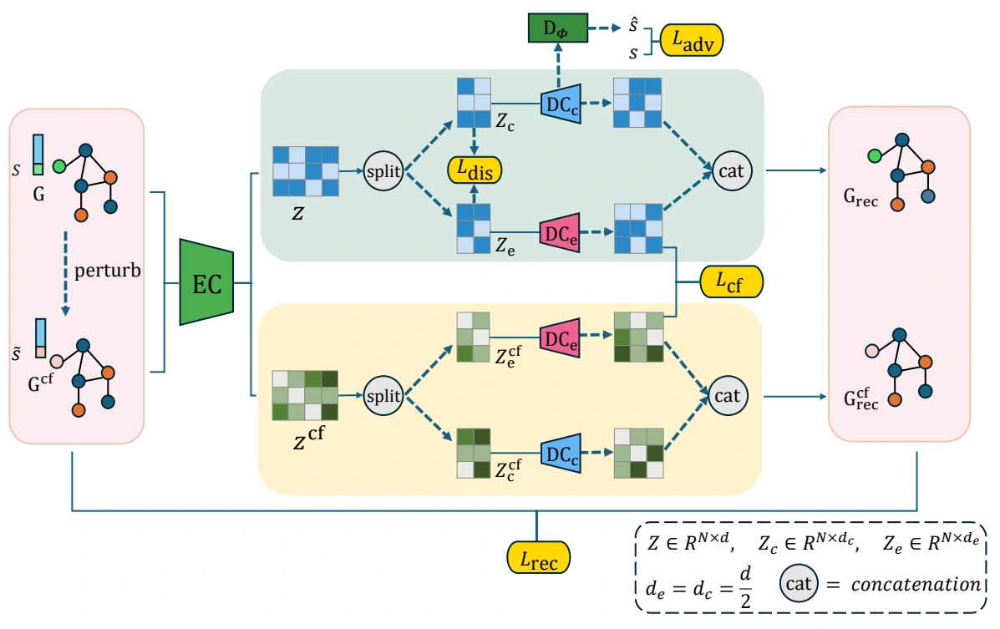

:::: {.profile}
::: {.profile-photo-wrap}

:::
::: {.profile-heading}
<h1>Sheng’en Li</h1>

::: {.profile-links}
[CV](assets/Shengen_Li_CV.pdf) / [GitHub](https://github.com/lsnnnnnnnn) / [Email](mailto:sl879@duke.edu)
:::
:::

::: {.profile-bio}
I am an undergraduate in Applied Mathematics and Computer Science in the dual-degree program at [Duke Kunshan University](https://www.dukekunshan.edu.cn/) and [Duke University](https://duke.edu/).

My research interests include reliable machine learning, causal and counterfactual inference, graph and temporal learning, scientific machine learning, model auditing, and numerical verification.
:::
::::

---

## News

- **[2026]** [COPF](https://arxiv.org/abs/2606.00700) was accepted to **ICML 2026**.
- **[2025]** [DECAF-GAD](https://arxiv.org/abs/2508.10785) was accepted to **ECAI 2025**.

---

## Selected Publications

::: {.publication}
### [COPF: An Online Framework for Deployment-Stable Counterfactual Fairness in Evolving Graphs](https://arxiv.org/abs/2606.00700)

**Sheng’en Li**, Dongmian Zou  
ICML 2026 · First author  
[paper](https://arxiv.org/abs/2606.00700)
:::

::: {.publication}
### [DECAF-GAD: Enhancing Fairness in Autoencoders for Node-Level Graph Anomaly Detection](https://arxiv.org/abs/2508.10785)

Shouju Wang\*, Yuchen Song\*, **Sheng’en Li\***, Dongmian Zou  
ECAI 2025 · Co-first author  
[paper](https://arxiv.org/abs/2508.10785)
:::

\* Equal contribution. [Full publication list](publications.qmd).

---

## Education

::: {.simple-row}
::: {}
**Duke Kunshan University & Duke University**  
B.S. in Applied Mathematics and Computer Science, dual-degree program  
GPA: 3.80/4.00
:::
::: {.row-date}
Expected Dec. 2026
:::
:::

Dean’s List with Distinction (Fall 2023, Spring 2024); Summer Research Scholar (2024, 2025).

---

## Research Experience

:::: {.research-row}

::: {}
### [Counterfactual Learning for Adaptive Decision Systems](projects.qmd#counterfactual-learning)

::: {.entry-meta}
Duke Kunshan University / Duke University · Jan. 2025 – Present
:::
::: {.research-summary}
Counterfactual estimation, online auditing, and fairness control for evolving graphs; COPF and its COMET extension.
:::
:::
::::

:::: {.research-row .research-row-text}

::: {}
### [Taylor-Model Reachability for Neural-Network-Controlled Systems](projects.qmd#verified-reachability)

::: {.entry-meta}
UIUC · Prof. Huan Zhang’s group · May 2026 – Present
:::
::: {.research-summary}
A PyTorch engine for validated ODE flowpipes, with step-level comparisons against Flow* and certified neural-network couplings.
:::
:::
::::

:::: {.research-row}

::: {}
### [Audit–Refine Partial-Physics Models for ECG-Based Electrolyte Inference](projects.qmd#audit-refine)

::: {.entry-meta}
Duke Kunshan University · Mar. 2026 – Aug. 2026
:::
::: {.research-summary}
Auditing scaffold adequacy and local identifiability, then testing targeted refinements on MIMIC-IV-ECG.
:::
:::
::::

:::: {.research-row}

::: {}
### [Contextual Information and Alarm Utility in Time-Series Anomaly Detection](projects.qmd#contextual-anomaly-detection)

::: {.entry-meta}
Duke Kunshan University · Signature Work · 2025 – 2026
:::
::: {.research-summary}
Matched experiments separate the value of temporal history from alarm timing, recall, and warning burden.
:::
:::
::::

:::: {.research-row}

::: {}
### [Fair Graph Anomaly Detection](projects.qmd#fair-graph-anomaly-detection)

::: {.entry-meta}
Duke Kunshan University · Jul. 2024 – May 2025
:::
::: {.research-summary}
DECAF-GAD combines causal disentanglement and counterfactual regularization to improve fairness in graph autoencoders.
:::
:::
::::

[More about my research](projects.qmd)

---

## Work Experience

::: {.simple-row}
::: {}
**Shangchen Private Fund** · Shanghai, China  
Quantitative Research Intern (Sep. 2026 – Present)  
Previously Quantitative Developer Intern (Jul. – Sep. 2026)
:::
::: {.row-date}
Jul. 2026 – Present
:::
:::

Liquidity-aware factor backtesting and macroeconomic consensus research, building on earlier work in financial-document retrieval and Python/SQL data pipelines.
