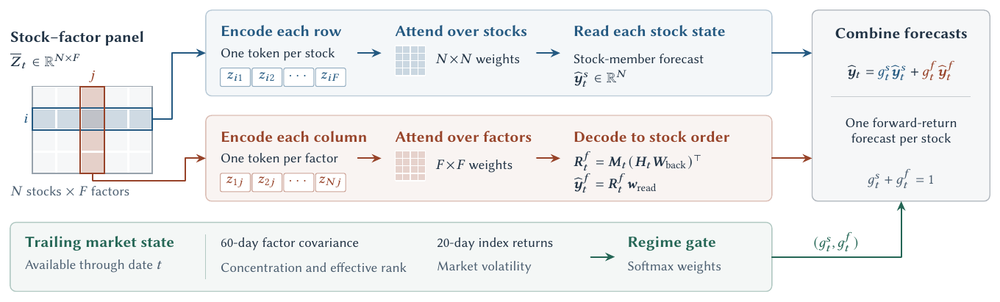
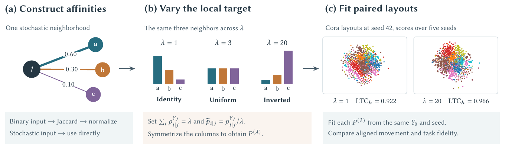
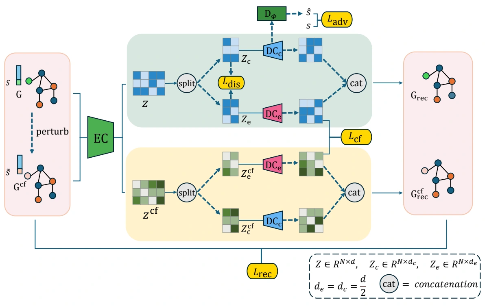

:::: {.profile}
::: {.profile-photo-wrap}

::: {.profile-links}
[CV](assets/Shengen_Li_CV.pdf) / [GitHub](https://github.com/lsnnnnnnnn) / [Email](mailto:sl879@duke.edu)
:::
:::
::: {.profile-heading}
<h1>Sheng’en Li</h1>
:::

::: {.profile-bio}
I am an undergraduate student in Applied Mathematics and Computer Science in the dual-degree program at [Duke Kunshan University](https://www.dukekunshan.edu.cn/) and [Duke University](https://duke.edu/).

I study how to evaluate and improve learning and decision systems under feedback, temporal dependence, and modeling uncertainty. My work spans counterfactual evaluation, sequential detection, and numerical verification.

Oh, and these are my [notes](blog/index.qmd){.intro-link .intro-notes} and [tools](tools.qmd){.intro-link .intro-tools}. You might want to have a look.
:::
::::

---

## News

- **[Nov. 2026]** I completed my [Signature Work showcase](projects.qmd#contextual-anomaly-detection).
- **[Apr. 2026]** [COPF](https://arxiv.org/abs/2606.00700) was accepted to **ICML 2026**.
- **[Jul. 2025]** [DECAF-GAD](https://arxiv.org/abs/2508.10785) was accepted to **ECAI 2025**.

---

## Selected Publications

::: {.publication}
### [COPF: An Online Framework for Deployment-Stable Counterfactual Fairness in Evolving Graphs](https://arxiv.org/abs/2606.00700)

**Sheng’en Li**, Dongmian Zou  
ICML 2026 · First author  
[paper](https://arxiv.org/abs/2606.00700)
:::

::: {.publication}
### [DECAF-GAD: Enhancing Fairness in Autoencoders for Node-Level Graph Anomaly Detection](https://arxiv.org/abs/2508.10785)

Shouju Wang\*, Yuchen Song\*, **Sheng’en Li\***, Dongmian Zou  
ECAI 2025 · Co-first author  
[paper](https://arxiv.org/abs/2508.10785)
:::

::: {.publication-note}
\* Equal contribution.
:::

::: {.publication-index}
[Full publication list →](publications.qmd)
:::

---

## Research Projects

:::: {.research-row}

::: {}
### [Counterfactual Learning for Adaptive Decision Systems](projects.qmd#counterfactual-learning)

::: {.entry-meta}
Duke Kunshan University / Duke University · Jan. 2025 – Present
:::
::: {.research-summary}
Counterfactual estimation, online auditing, and fairness control for link recommendation on evolving graphs.
:::
:::
::::

:::: {.research-row}

::: {}
### [Taylor-Model Reachability for Neural-Network-Controlled Systems](projects.qmd#verified-reachability)

::: {.entry-meta}
UIUC · Prof. Huan Zhang’s group · May 2026 – Present
:::
::: {.research-summary}
A PyTorch engine for validated ODE flowpipes, with step-level comparisons against Flow* and certified neural-network couplings.
:::
:::
::::

:::: {.research-row}

::: {}
### [Audit–Refine Partial-Physics Models for ECG-Based Electrolyte Inference](projects.qmd#audit-refine)

::: {.entry-meta}
Duke Kunshan University · Mar. 2026 – Aug. 2026
:::
::: {.research-summary}
Auditing scaffold adequacy and local identifiability, then testing targeted refinements on MIMIC-IV-ECG.
:::
:::
::::

:::: {.research-row}

::: {}
### [FToken: Reading Stock–Factor Panels Along Two Axes](projects.qmd#ftoken)

::: {.entry-meta}
Duke Kunshan University · 2026
:::
::: {.research-summary}
Two attention models read the same daily panel across stocks and across factors, then combine their forecasts of stock returns.
:::
:::
::::

:::: {.research-row}

::: {}
### [LambdaLens: How Rescaling Neighbors Changes a Graph Embedding](projects.qmd#lambdalens)

::: {.entry-meta}
Duke Kunshan University · 2026
:::
::: {.research-summary}
Tracking neighbor weights and node positions reveals why the same parameter change can reshape one graph embedding and leave another almost unchanged.
:::
:::
::::

:::: {.research-row}

::: {}
### [Contextual Information and Alarm Utility in Time-Series Anomaly Detection](projects.qmd#contextual-anomaly-detection)

::: {.entry-meta}
Duke Kunshan University · Signature Work · 2025 – 2026
:::
::: {.research-summary}
Matched experiments separate the value of temporal history from alarm timing, recall, and warning burden.
:::
:::
::::

:::: {.research-row}

::: {}
### [Fair Graph Anomaly Detection](projects.qmd#fair-graph-anomaly-detection)

::: {.entry-meta}
Duke Kunshan University · Jul. 2024 – May 2025
:::
::: {.research-summary}
DECAF-GAD combines causal disentanglement and counterfactual regularization to improve fairness in graph autoencoders.
:::
:::
::::

[More about my research](projects.qmd)

---

## Work Experience

::: {.simple-row}
::: {}
**Shangchen Private Fund** · Shanghai, China  
Quantitative Research Intern (Sep. 2026 – Present)  
Previously Quantitative Developer Intern (Jul. – Sep. 2026)
:::
::: {.row-date}
Jul. 2026 – Present
:::
:::

Liquidity-aware factor backtesting and macroeconomic consensus research, building on earlier work in financial-document retrieval and Python/SQL data pipelines.

