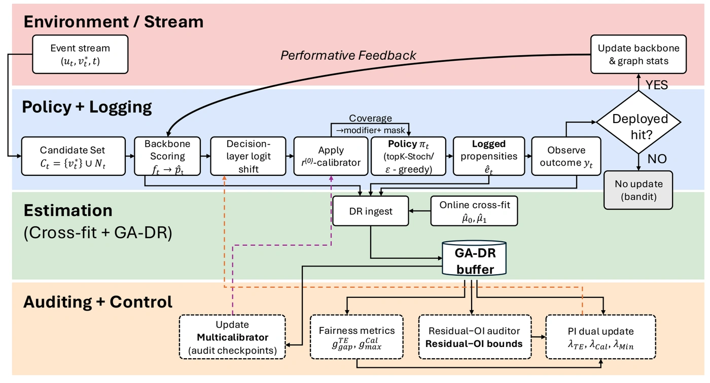
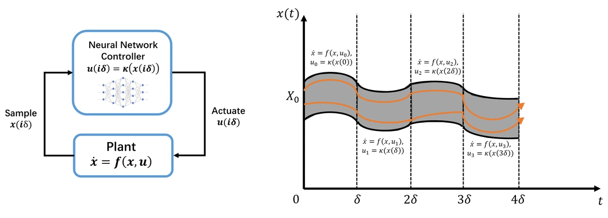
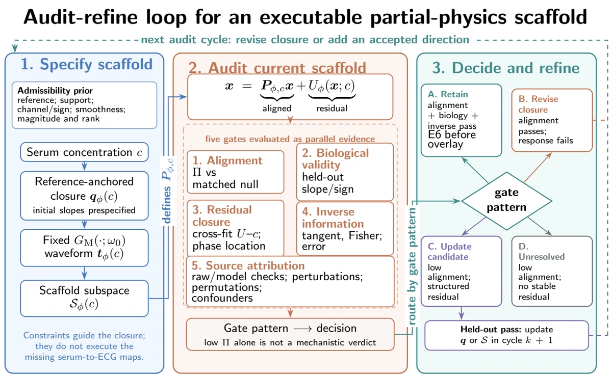
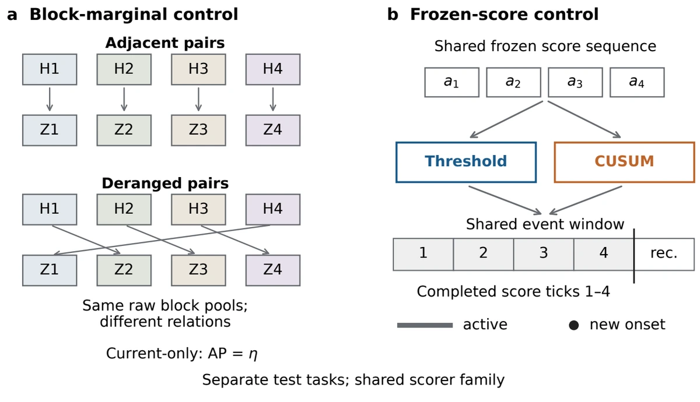
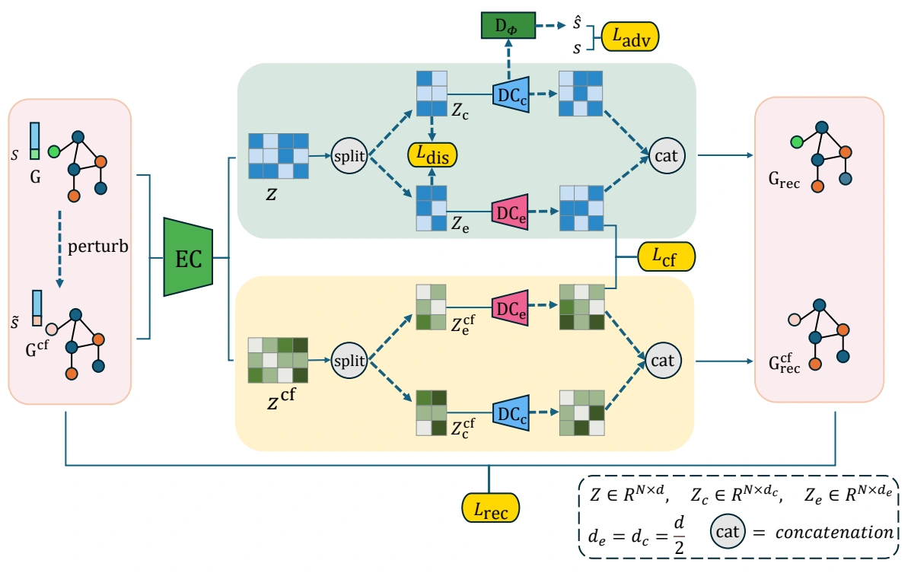

::: {.research-intro}
I study how learning systems behave under changing data, imperfect models, and deployment feedback. My work spans counterfactual fairness, numerical verification, scientific machine learning, and sequential detection.
:::

## Counterfactual Learning for Adaptive Decision Systems {#counterfactual-learning}

:::: {.research-detail}
::: {.research-visual}

COPF · Protocol flowchart
:::
::: {.research-copy}
::: {.entry-meta}
**Duke Kunshan University / Duke University** · Jan. 2025 – Present  
Advised by Prof. Dongmian Zou and Prof. Fan Wei
:::

Online recommenders change the graph and feedback they later learn from, so fairness measured on logged outcomes can drift after deployment. I developed **COPF**, a decision-layer framework that combines explicit exploration and propensity logging with graph-aware doubly robust estimation. An online multicalibration auditor and primal–dual controller then monitor and adjust group-level exposure disparities.

Evaluations on two Temporal Graph Benchmark streams and a controlled synthetic stream show reduced worst-case disparity spikes with modest effects on ranking utility. I am extending this work in **COMET** to study counterfactual moments under weak overlap and dependent feedback.

::: {.research-links}
[Paper · ICML 2026](https://arxiv.org/abs/2606.00700) · [Code](https://github.com/lsnnnnnnnn/COPF) · First author
:::
:::
::::

## Taylor-Model Reachability for Neural-Network-Controlled Systems {#verified-reachability}

:::: {.research-detail}
::: {.research-visual}

NN control and flowpipes 
Illustration: Xiangru Zhong
:::
::: {.research-copy}
::: {.entry-meta}
**University of Illinois Urbana-Champaign** · May 2026 – Present  
Research collaboration with Prof. Huan Zhang’s group
:::

I am developing a **PyTorch Taylor-model engine** for safety verification of neural-network-controlled systems. The engine propagates polynomial approximations together with validated remainder bounds through nonlinear ODEs, combining interval arithmetic and Picard iteration. My work includes step-level comparisons against **Flow\*** to diagnose polynomial truncation, remainder growth, enclosure tightness, and CPU/GPU consistency.

The broader project connects GPU-batched flowpipes to CROWN-type neural-network verifiers through certified polynomial couplings. These interfaces preserve dependencies that interval-only bounds discard, helping assess how numerical precision and controller bounds affect the reachable sets used to certify safety.
:::
::::

## Audit–Refine Partial-Physics Models for ECG-Based Electrolyte Inference {#audit-refine}

:::: {.research-detail}
::: {.research-visual}

Audit–Refine · Framework overview
:::
::: {.research-copy}
::: {.entry-meta}
**Duke Kunshan University** · Mar. 2026 – Aug. 2026  
Advised by Prof. Shixin Xu and Prof. Dongmian Zou
:::

I co-developed an **Audit–Refine framework** for testing whether a partial-physics model’s mechanistic scaffold is supported by data. In ECG-based electrolyte inference, a projective Plausibility Index measures waveform alignment, while tangent and Fisher-information diagnostics assess whether electrolyte concentrations can be recovered locally. The framework combines matched null models, held-out inverse error, residual structure, and robustness checks to decide which refinements to accept.

I built and validated analyte-specific **MIMIC-IV-ECG** pipelines and evaluated reduced-rank potassium refinements. Four of seven electrolyte–scaffold hypotheses passed the audit; the accepted potassium spline reduced held-out MAE from **0.417 to 0.396 mEq/L**, a **5.0%** relative improvement.

::: {.research-links}
Submitted to *Artificial Intelligence in Medicine* · Co-first author
:::
:::
::::

## Contextual Information and Alarm Utility in Time-Series Anomaly Detection {#contextual-anomaly-detection}

:::: {.research-detail}
::: {.research-visual}

Signature Work · Experimental design
:::
::: {.research-copy}
::: {.entry-meta}
**Duke Kunshan University** · 2025 – 2026  
Signature Work · Advised by Prof. Dongmian Zou
:::

My Signature Work separates three questions in anomaly detection: **what temporal context adds, how much evidence a model captures, and when its scores produce useful warnings**. I designed matched-block experiments that preserve observed data while changing history–current pairings, proving chance-level ranking for fixed current-only detectors. A covariance-based Markov model trained on normal data measures the value of contextual relationships.

I compare thresholding and accumulation on identical scores, tracking event recall, detection delay, and warning burden. CUSUM increased four-block recall by **9.6 and 2.9 percentage points** in two simulated settings. Evaluation across **119 real series from five sources** found no consistent detection gain from accumulation, highlighting the need to evaluate recall alongside the frequency of warnings during normal periods.

::: {.research-links}
[Research note: from anomaly scores to useful alarms](blog/2026-11-11-alarm-quality.qmd)
:::
:::
::::

## Fair Graph Anomaly Detection {#fair-graph-anomaly-detection}

:::: {.research-detail}
::: {.research-visual}

DECAF-GAD · Model architecture
:::
::: {.research-copy}
::: {.entry-meta}
**Duke Kunshan University** · Jul. 2024 – May 2025  
Summer Research Scholar · Advised by Prof. Dongmian Zou
:::

Graph autoencoders can mistake differences between demographic groups for anomalies. I co-developed **DECAF-GAD**, a fairness-aware framework that uses a structural causal model to separate sensitive information from the representations used for detection. A shared encoder processes original and counterfactual graphs, while disentanglement, adversarial learning, and counterfactual consistency losses guide reconstruction.

The framework can be added to existing autoencoder-based detectors. Through experiments on synthetic and real-world graphs and component ablations, we evaluated the fairness–utility trade-off and found improved fairness metrics while maintaining competitive anomaly detection performance.

::: {.research-links}
[Paper · ECAI 2025](https://arxiv.org/abs/2508.10785) · [Code](https://github.com/Tlhey/decaf_code) · Co-first author
:::
:::
::::
