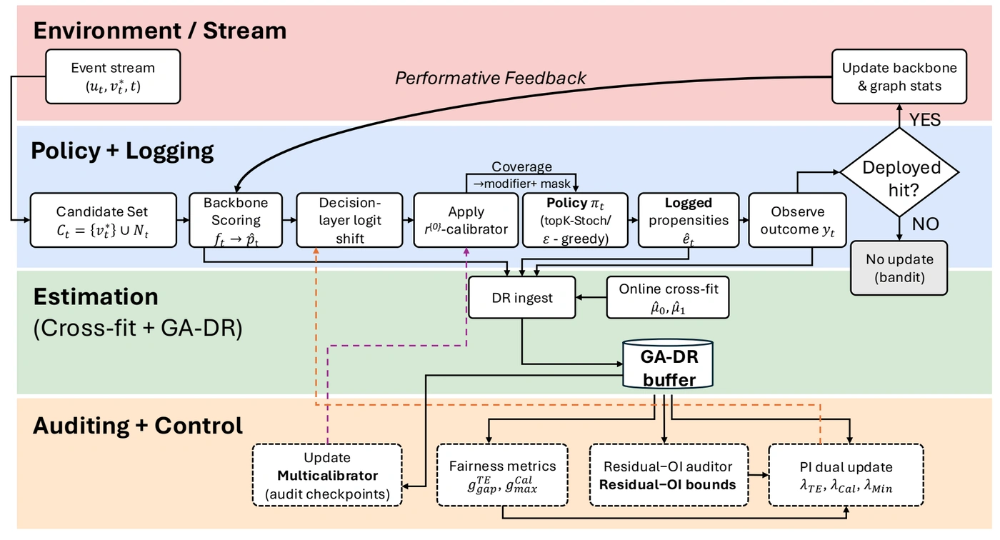
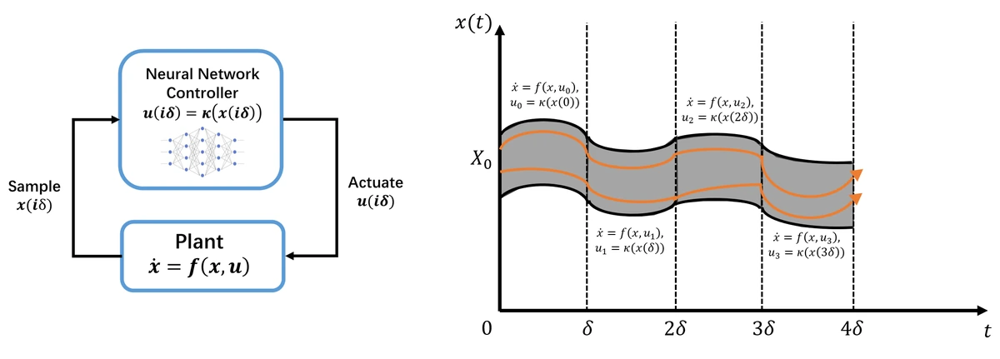
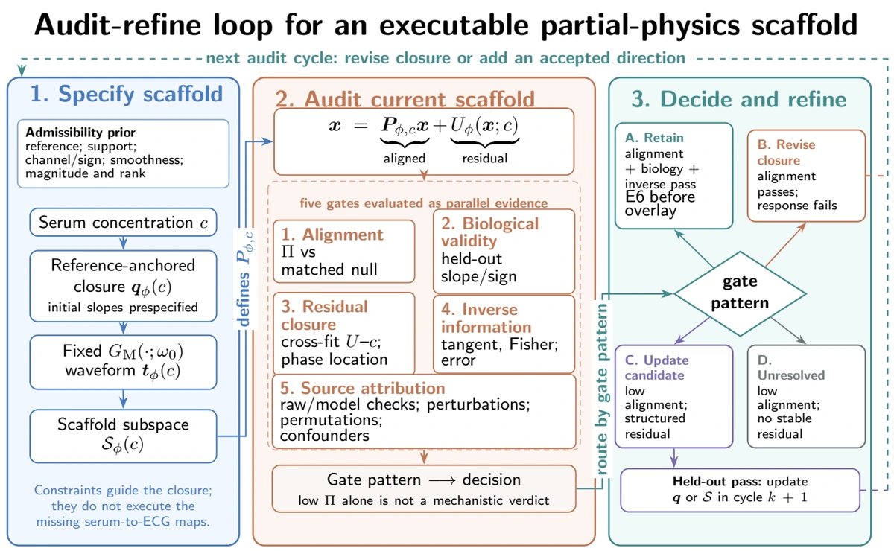
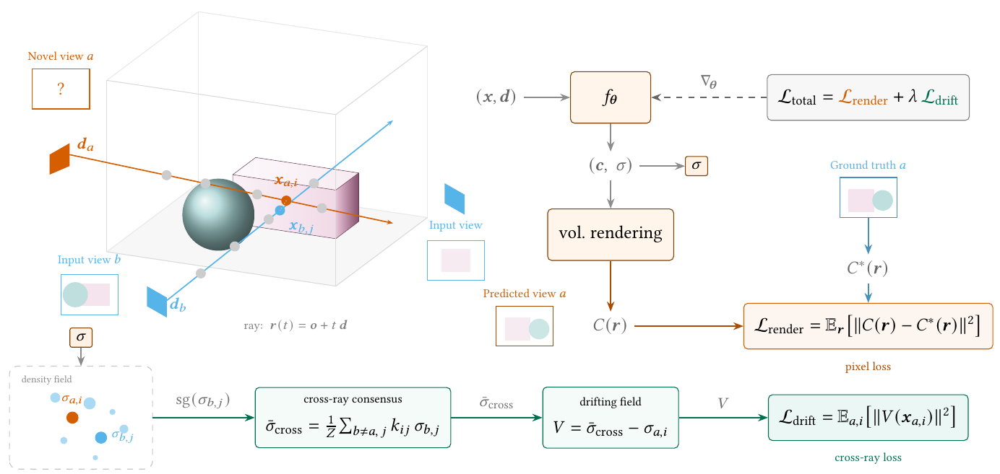
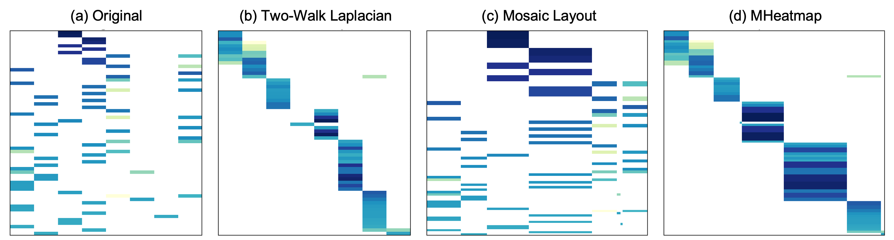
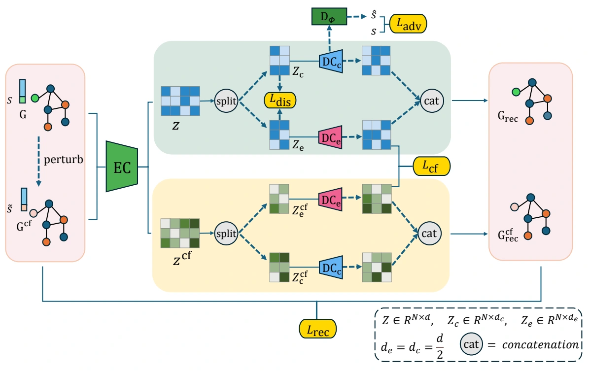

::: {.research-intro}
I study how learning systems behave under changing data, imperfect models, and deployment feedback. My work spans counterfactual fairness, numerical verification, scientific machine learning, sequential detection, matrix visualization, and 3D reconstruction.
:::

## Counterfactual Learning for Adaptive Decision Systems {#counterfactual-learning}

:::: {.research-detail}
::: {.research-visual}

COPF · Protocol flowchart
:::
::: {.research-copy}
::: {.entry-meta}
**Duke Kunshan University / Duke University** · Jan. 2025 – Present  
Advised by Prof. Dongmian Zou and Prof. Fan Wei
:::

Online recommenders change the graph and feedback they later learn from, so fairness measured on logged outcomes can drift after deployment. I developed **COPF**, a decision-layer framework that combines explicit exploration and propensity logging with graph-aware doubly robust estimation. An online multicalibration auditor and primal–dual controller then monitor and adjust group-level exposure disparities.

Evaluations on two Temporal Graph Benchmark streams and a controlled synthetic stream show reduced worst-case disparity spikes with modest effects on ranking utility.

::: {.research-links}
[Paper · ICML 2026](https://arxiv.org/abs/2606.00700) · [Code](https://github.com/lsnnnnnnnn/COPF) · First author
:::
:::
::::

## COMET: Counterfactual Moment Auditing {#comet}

:::: {.research-detail .research-detail--text}
::: {.research-copy}
::: {.entry-meta}
**Working project** · Counterfactual inference and dependent data
:::

A counterfactual audit can return a valid confidence interval and still leave a decision unresolved. I am developing **COMET** to study what an audit can establish when relevant outcomes are rarely observed, observations are dependent, and outcomes can have heavy tails. The framework expresses policy and subgroup comparisons as signed moments, with explicit assumptions about exposure probabilities, dependence, and the bias introduced by clipping extreme observations.

Current work examines how information about shared random sources can tighten uncertainty bounds. A separate analysis asks when a bound on the difference between potential outcomes permits sharper inference than bounds on their levels alone. I use finite-sample theory and controlled synthetic experiments to test when these additional assumptions yield intervals narrow enough to detect a violation or support a policy comparison.
:::
::::

## Taylor-Model Reachability for Neural-Network-Controlled Systems {#verified-reachability}

:::: {.research-detail}
::: {.research-visual}

NN control and flowpipes 
Illustration: Xiangru Zhong
:::
::: {.research-copy}
::: {.entry-meta}
**University of Illinois Urbana-Champaign** · May 2026 – Present  
Research collaboration with Prof. Huan Zhang’s group
:::

I am developing a **PyTorch Taylor-model engine** for safety verification of neural-network-controlled systems. The engine propagates polynomial approximations together with validated remainder bounds through nonlinear ODEs, combining interval arithmetic and Picard iteration. My work includes step-level comparisons against **Flow\*** to diagnose polynomial truncation, remainder growth, enclosure tightness, and CPU/GPU consistency.

The broader project connects GPU-batched flowpipes to CROWN-type neural-network verifiers through certified polynomial couplings. These interfaces preserve dependencies that interval-only bounds discard, helping assess how numerical precision and controller bounds affect the reachable sets used to certify safety.
:::
::::

## Audit–Refine Partial-Physics Models for ECG-Based Electrolyte Inference {#audit-refine}

:::: {.research-detail}
::: {.research-visual}

Audit–Refine · Framework overview
:::
::: {.research-copy}
::: {.entry-meta}
**Duke Kunshan University** · Mar. 2026 – Aug. 2026  
Advised by Prof. Shixin Xu and Prof. Dongmian Zou
:::

I co-developed an **Audit–Refine framework** for testing whether a partial-physics model’s mechanistic scaffold is supported by data. In ECG-based electrolyte inference, a projective Plausibility Index measures waveform alignment, while tangent and Fisher-information diagnostics assess whether electrolyte concentrations can be recovered locally. The framework combines matched null models, held-out inverse error, residual structure, and robustness checks to decide which refinements to accept.

I built and validated analyte-specific **MIMIC-IV-ECG** pipelines and evaluated reduced-rank potassium refinements. Four of seven electrolyte–scaffold hypotheses passed the audit; the accepted potassium spline reduced held-out MAE from **0.417 to 0.396 mEq/L**, a **5.0%** relative improvement.

::: {.research-links}
Submitted to *Artificial Intelligence in Medicine* · Co-first author
:::
:::
::::

## DriftNeRF: Sparse-View 3D Reconstruction {#driftnerf}

:::: {.research-detail}
::: {.research-visual}

DriftNeRF · Cross-ray density consensus
:::
::: {.research-copy}
::: {.entry-meta}
**Duke Kunshan University** · Sparse-view 3D reconstruction
:::

With only a few training images, a NeRF can reproduce observed pixels while assigning inconsistent densities to nearby 3D points. I co-developed **DriftNeRF** to measure this disagreement across camera rays and turn it into a training signal. For each sample, it pools nearby density predictions from other rays into a consensus target, holds that target fixed during the update (**stop-gradient**), and adjusts the sample's density toward it alongside the standard rendering objective.

The regularizer uses only sampled positions, ray identifiers, and predicted densities, requiring no pretrained model, external geometry, or additional images. Across **NeRF-Synthetic, DTU, and LLFF**, it improves three-view PSNR by **0.42–0.65 dB** over the strongest tested MLP-NeRF baseline. Experiments also show that the same loss transfers to a hash-grid representation.

::: {.research-links}
[Paper](https://arxiv.org/abs/2610.29106) · Submitted to CVPR 2027 · Co-first author
:::
:::
::::

## MHeatmap: Reordering and Visualizing Rectangular Matrices {#mheatmap}

:::: {.research-detail}
::: {.research-visual}

MHeatmap · Workflow comparison
:::
::: {.research-copy}
::: {.entry-meta}
**Duke Kunshan University** · Matrix visualization and spectral methods
:::

A matrix can contain clear groups and still look scattered when its rows and columns are in the wrong order. I co-developed **MHeatmap** to make these relationships easier to inspect. Its **Two-Walk** method combines direct row-to-column connections with similarities between rows that share columns, and between columns that share rows. A graph Laplacian then provides coordinated orders for both axes.

The **Mosaic layout** adds a separate visual cue: row heights and column widths reflect their totals, while color shows each observed entry. We derive a sparse computation that avoids forming dense similarity matrices and evaluate the ordering on **300 synthetic matrices and seven real datasets**. The largest gains appear when shared neighborhoods capture the underlying structure.

::: {.research-links}
[Paper · arXiv preprint](https://arxiv.org/abs/2610.29114)
:::
:::
::::

## Contextual Information and Alarm Utility in Time-Series Anomaly Detection {#contextual-anomaly-detection}

:::: {.research-detail}
::: {.research-visual}

Signature Work · Experimental design
:::
::: {.research-copy}
::: {.entry-meta}
**Duke Kunshan University** · 2025 – 2026  
Signature Work · Advised by Prof. Dongmian Zou
:::

My Signature Work separates three questions in anomaly detection: **what temporal context adds, how much evidence a model captures, and when its scores produce useful warnings**. I designed matched-block experiments that preserve observed data while changing history–current pairings, proving chance-level ranking for fixed current-only detectors. A covariance-based Markov model trained on normal data measures the value of contextual relationships.

I compare thresholding and accumulation on identical scores, tracking event recall, detection delay, and warning burden. CUSUM increased four-block recall by **9.6 and 2.9 percentage points** in two simulated settings. Evaluation across **119 real series from five sources** found no consistent detection gain from accumulation, highlighting the need to evaluate recall alongside the frequency of warnings during normal periods.

::: {.research-links}
[Research note: How to Miss Two Events Without Hurting Your Score](blog/2026-11-11-alarm-quality.qmd)
:::
:::
::::

## Fair Graph Anomaly Detection {#fair-graph-anomaly-detection}

:::: {.research-detail}
::: {.research-visual}

DECAF-GAD · Model architecture
:::
::: {.research-copy}
::: {.entry-meta}
**Duke Kunshan University** · Jul. 2024 – May 2025  
Summer Research Scholar · Advised by Prof. Dongmian Zou
:::

Graph autoencoders can mistake differences between demographic groups for anomalies. I co-developed **DECAF-GAD**, a fairness-aware framework that uses a structural causal model to separate sensitive information from the representations used for detection. A shared encoder processes original and counterfactual graphs, while disentanglement, adversarial learning, and counterfactual consistency losses guide reconstruction.

The framework can be added to existing autoencoder-based detectors. Through experiments on synthetic and real-world graphs and component ablations, we evaluated the fairness–utility trade-off and found improved fairness metrics while maintaining competitive anomaly detection performance.

::: {.research-links}
[Paper · ECAI 2025](https://arxiv.org/abs/2508.10785) · [Code](https://github.com/Tlhey/decaf_code) · Co-first author
:::
:::
::::
